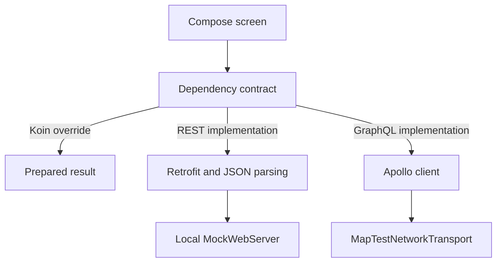

# Android UI Test DSL

A small, standalone Android app demonstrating how to describe UI test environments with a Kotlin DSL. No backend account or external service is required.

The sample covers REST responses with MockWebServer and Retrofit, typed GraphQL responses with Apollo, dependency overrides with Koin, and feature flags. A Page Object keeps actions and assertions separate from environment setup.

## A complete scenario

```kotlin
class RestPromoTest : BaseUiTest() {
    @get:Rule val rule = makeUiTestRule {
        restMockServer {
            POST("/promocodes") returns 200 withBodyContaining "\"code\":\"EXPIRED\"" withJson
                """{"accepted":false,"message":"Срок действия промокода истёк"}"""
        }
    }

    @Test fun restErrorAppearsAtTheInput() {
        PromoScreen(composeTestRule).apply {
            submit("EXPIRED")
            assertResult("Срок действия промокода истёк")
        }
    }
}
```

The app sends a real local HTTP request. The prepared business error is parsed and displayed by the UI. HTTP 200 represents a successful exchange; `accepted: false` represents a rejected promo code.

## Run it

Open the project in Android Studio. Requirements:

- JDK 17 (or a Gradle runtime with a JDK 17 toolchain available).
- Android SDK Platform 36.
- An Android device or emulator on API 26 or later for UI tests.

Set `ANDROID_HOME`, or create an untracked `local.properties` with `sdk.dir=/path/to/Android/sdk`.

```sh
./gradlew :app:assembleDebug :app:assembleDebugAndroidTest :app:testDebugUnitTest
./gradlew :app:connectedDebugAndroidTest
```

The second command requires a running device. Dependencies are downloaded from public repositories on the first build. Direct dependency versions and the Gradle distribution checksum are pinned.

Run the app normally to try the offline defaults: enter `EXPIRED` to see a rejection; any other nonblank code succeeds. The products button loads a sample item. UI text is in Russian. Network implementations are selected by tests, so normal use does not contact a server.

## Where to start

| Source | Purpose |
| --- | --- |
| [Dependencies.kt](app/src/main/java/example/uitestdsl/Dependencies.kt) | Contracts, offline defaults, REST and GraphQL implementations |
| [MainActivity.kt](app/src/main/java/example/uitestdsl/MainActivity.kt) | Compose screen that calls the dependencies |
| [RestMockDsl.kt](app/src/sharedTest/kotlin/example/uitestdsl/testing/RestMockDsl.kt) | Request matching and response builder |
| [BaseUiTest.kt](app/src/androidTest/java/example/uitestdsl/testing/BaseUiTest.kt) | Rule ordering, Koin overrides, flags, resource cleanup |
| [PromoScreen.kt](app/src/androidTest/java/example/uitestdsl/testing/PromoScreen.kt) | Page Object and assertions with condition-based waits |
| [PromoTests.kt](app/src/androidTest/java/example/uitestdsl/PromoTests.kt) | Four UI tests and a feature-level base class |
| [RestMockDslTest.kt](app/src/test/java/example/uitestdsl/testing/RestMockDslTest.kt) | JVM tests using actual local HTTP requests |

## Choose the boundary of the test



These are alternative dependency implementations, not successive stages of one request.

- `KoinPromoTest` checks the UI response to an injected result, without networking.
- `RestPromoTest` includes Retrofit, HTTP and JSON parsing.
- `GraphQlProductsTest` supplies typed Apollo data; it does not test HTTP or JSON decoding.
- `DisabledPromoTest` checks that disabling a flag removes the input and submit button.

## Scope and limitations

REST matching uses the exact path, including the query string. The first matching rule wins; unmatched requests return 404. After `withJsonSequence` is exhausted, responses use the body configured by `withJson` (empty by default).

Each test creates a new environment before launching the Activity. The Activity closes before Koin and network resources are released. Koin uses the process-global container: parallel tests in one process are not supported. The app has no persistent state to reset. Flags are Boolean values in this sample.

This is a teaching example, not a production testing framework. [Implementation notes](docs/implementation.md) explain the lifecycle and tradeoffs.

## Validation

Verified on October 5, 2026:

- App and instrumentation APKs built successfully.
- 2 JVM tests passed.
- 4 UI tests passed on an Android 15 / API 35 arm64 emulator.
- Android Lint reported no errors; warnings include newer dependency versions and a missing application icon.

This is a single-device verification, not a compatibility matrix. Build outputs, local SDK paths and emulator data are excluded from version control.
