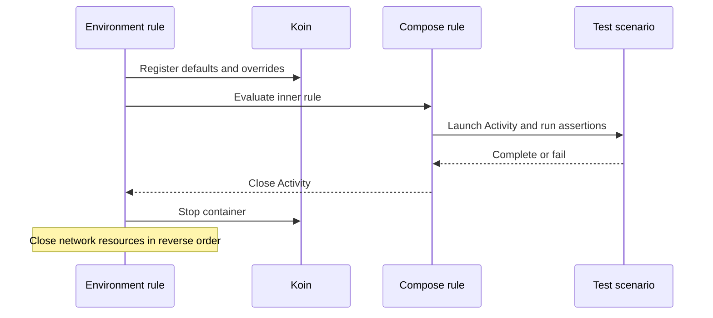

# How the test environment works

The screen depends on small interfaces. Normal app startup registers offline implementations, while each test chooses the implementations needed for its scenario.

`makeUiTestRule` accepts `Module.() -> Unit`, allowing ordinary Koin `factory` and `single` declarations alongside the helper DSLs. The configuration runs inside the outer rule, so constructors do not start servers or allocate Apollo clients.

Cleanup attempts every registered resource even when one cleanup operation fails. If the test already failed, cleanup errors are attached as suppressed exceptions rather than replacing the original failure.

## REST

`RestMockDsl` stores request rules and supplies a MockWebServer dispatcher. A rule matches the HTTP method, exact path and optional body fragment. The request body is cloned before inspection, preserving it for other matchers and diagnostics.

`restMockServer` starts the server, builds Retrofit against its loopback URL and overrides `AddPromocode` with `RestAddPromocode`. This implementation sends the entered code, parses the JSON response and returns a domain result to the screen.

Cleartext traffic is enabled only in the debug manifest for local HTTP testing. The DSL deliberately leaves advanced routing, query matching and response delays out of scope.

## GraphQL

`mockGraphQl` constructs an Apollo client with `MapTestNetworkTransport`. The test registers a response for the generated `ProductsQuery`, then presses the screen's load button. `GraphQlGetProducts` executes the query against that client.

The schema and operation live in `app/src/main/graphql`; Apollo generates the Kotlin models during the build. Typed mocks cover handling of these models rather than the wire format.

## Koin and flags

Direct `factory<AddPromocode>` overrides are appropriate when the scenario only needs a known operation result. `ExpiredPromoUiTest` demonstrates a feature-level wrapper for shared setup.

`mockFeatureFlags` registers an immutable snapshot of Boolean settings. The Activity resolves these settings before its first composition. This example does not implement dynamic flag updates while the screen is open.

## Assertions

`PromoScreen` waits for the expected tagged text and then checks both visibility and exact content. An unexpected network error therefore cannot pass as a successful business-error assertion. The disabled-flag scenario checks absence of both controls as well as the explanatory message.

## Reference documentation

- [Koin: starting on Android](https://insert-koin.io/docs/reference/koin-android/start/)
- [Apollo Kotlin: mocking GraphQL responses](https://www.apollographql.com/docs/kotlin/testing/mocking-graphql-responses)

The sample pins its dependency versions; current upstream documentation may describe newer APIs.
